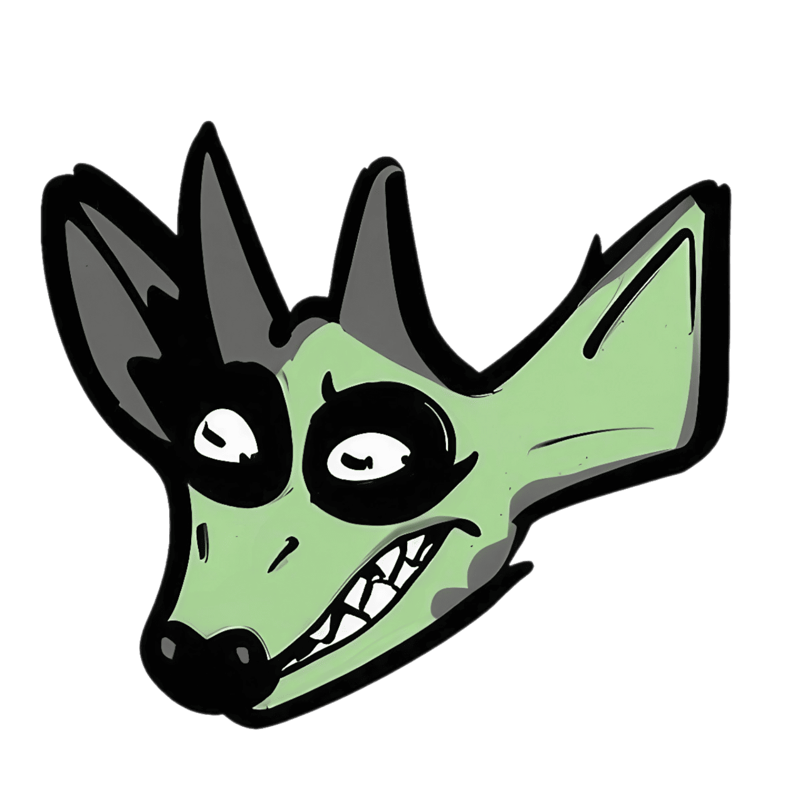
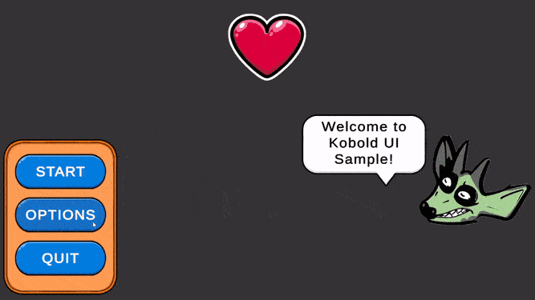

<div align="center" valign="middle" style="page-break-after: always;">
<br>
    <h1>Kobold UI</h1>
    
    <h2>uGUI framework for Unity</h2>
    <br>
</div>

# Dependencies
- **Unitask** – a package for more efficient and convenient async/await handling in Unity
  * [https://github.com/Cysharp/UniTask](https://github.com/Cysharp/UniTask)
- **Dotween** – a plugin for tween animations
  * [https://dotween.demigiant.com](https://dotween.demigiant.com/getstarted.php)
- **Alchemy** (optional) – extensions for the inspector
  * [https://github.com/AnnulusGames/Alchemy](https://github.com/AnnulusGames/Alchemy)
- **Odin Inspector** (optional) – alternative inspector extensions
  * [https://odininspector.com](https://odininspector.com)


# Installation
1. Install UniTask and DOTween. A DI container is optional.
2. Generate the `.asmdef` for **Dotween**:
`Tools -> Demigiant -> DOTween Utility Panel -> Create .asmdef`
3. Add the define to:`Edit -> Project Settings -> Player -> Scripting Define Symbols`
```
UNITASK_DOTWEEN_SUPPORT
```
4. If you installed **Alchemy**, also add the define:
```
KOBOLD_ALCHEMY_SUPPORT
```
5. If you installed **Odin Inspector**, add the define:
```
KOBOLD_ODIN_SUPPORT
```
6. Install the plugin via Git: 
```
https://github.com/KienanUnique/KoboldUiFramework.git
```

# Configure windows

Add window prefabs to a `WindowCatalog` asset (`Assets -> Create -> KoboldUi -> Window Catalog`).
Choose `Local` or `Project` for each entry. No per-window binding code is required.

```csharp
using KoboldUi.Composition;
using KoboldUi.Composition.Manual;

var project = new ManualUiResolver().AddInstance<ISettingsStore>(settingsStore);
var local = project.CreateScope().AddInstance<ILevelState>(levelState);
var ui = new UiBootstrap(localCanvas, projectCanvas);
ui.Initialize(windowCatalog, project, local);
ui.Open<SettingsWindow>();
```

Use `[UiInject]` on window, view and child-component members. Controllers receive
services in their constructors and the view explicitly through a constructor parameter
or their inherited `View` member. Default animation assets can be registered by type.

The built-in manual resolver needs no DI package. Optional Zenject and VContainer
adapters use separate assemblies and the `KOBOLD_ZENJECT_SUPPORT` or
`KOBOLD_VCONTAINER_SUPPORT` define. See [DI migration](docs/DI_MIGRATION.md).


# Useful Links
- [Documentation (En)](https://github.com/KienanUnique/KoboldUiFramework/wiki/Documentation-EN)
- [Documentation (Ru)](https://github.com/KienanUnique/KoboldUiFramework/wiki/Documentation-RU)
- [Start Guide (En)](https://github.com/KienanUnique/KoboldUiFramework/wiki/Start-Guide-EN)
- [Start Guide (Ru)](https://github.com/KienanUnique/KoboldUiFramework/wiki/Start-Guide-RU)
- [Sample](https://github.com/KienanUnique/KoboldUiSample)

<div align="center" valign="middle" style="page-break-after: always;">
<br>
    
<br>
</div>
